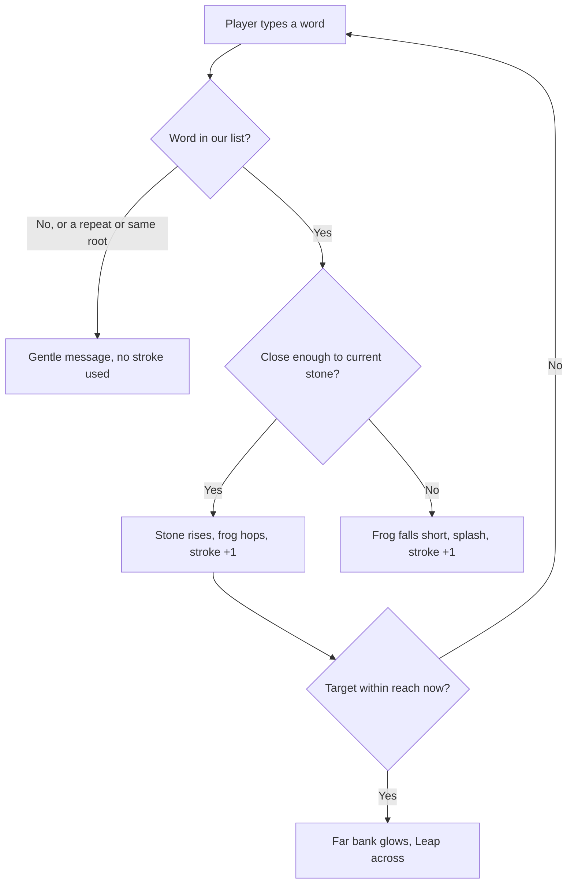
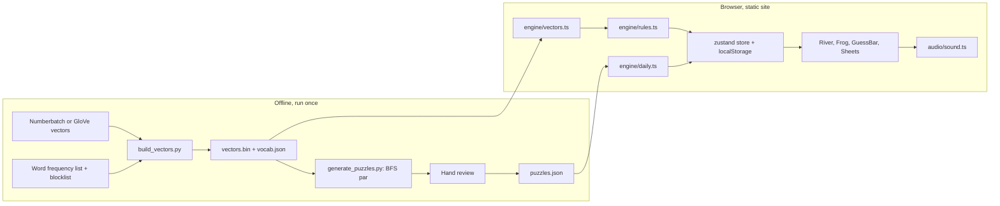

# StepStone: Game Design & Architecture

A cozy daily word game. Players type associated words to lay stepping stones across a river, from a start word to a target word. A word-similarity model running in the browser judges each hop, and the crossing is scored golf-style against par.

---

## Part 1: Concept

### The pitch
Today's river runs from HONEY to SWEATER. Type a word linked to the stone you're standing on and a new stone rises out of the water. Your little frog hops onto it. Get across in as few strokes as you can.

### The screen (portrait-first)
- **Starting bank** at the bottom, start word carved in a mossy stone. **Far bank** at the top with the target word.
- **Stones land higher up the river the closer their meaning is to the target**, a gentle warmer/colder signal that doesn't spell out the answer.
- **Stones show link strength**: strong links are mossy and solid, middling ones plain, barely-valid ones wobble.
- **Guess bar** at the bottom: a big rounded input, a Whisper (hint) button, and Undo.
- When the target is within reach of the current stone, **the far bank glows** and a "Leap across" button appears.

### One turn


### Rules and scoring
- **Strokes** = stones laid + splashes + whispers + the final leap. Typos, unknown words, repeats, and other forms of earlier stones never cost a stroke.
- **Par** = fewest hops the solver found, counting the final leap.
- **Lilies**: 3 at par, 2 at par +1 or +2, 1 for any finish. You can't fail.
- **Whisper** reveals a reachable word that moves you toward the far bank; costs one stroke. **Undo** steps back a stone for free; spent strokes aren't refunded.
- **After the crossing** the game shows the best route with a one-line note per link, then a spoiler-free share card:

```
StepStone #12 🐸
HONEY → SWEATER
🪨🪨💦🪨🌿
4 strokes · par 3
```

### Modes
Daily (one river per day, same for everyone, numbered from launch, resets at local midnight) and Practice (random rivers). Archive later.

### Versus Chainle
Chainle is five independent rounds: find one word that connects the given clues. StepStone is one multi-hop journey with visible progress, splashes, and par. Closer to a cozy walk than a quiz.

---

## Part 2: System design



### Judging a hop
- **Vectors**: 20,000 common English base words plus 1,733 rarer everyday things (see Everyday words in Part 4), reduced to 160 numbers each (PCA), normalized, stored as 1 byte per number. With a per-word reach threshold that's 3.56 MB, loaded in the background on first visit. A sweep picked 160: at 128 dimensions only 78% of each word's top-300 neighbours survive and 91% of sanity links pass; at 160 it's 83% and 94%, the same acceptance as 192 for less data.
- **Aliases**: plurals and verb forms map to their base word. They're accepted but count as the same root.
- **Reach rule**: B is within reach of A if B is in A's top K neighbors or A is in B's, or if the two form a common phrase (park bench, campfire; see Phrase links in Part 4). Rank-based because raw similarity varies a lot from word to word.
- **Link strength**: rank ≤ 25 strong, ≤ 150 sturdy, ≤ K wobbly. Rank between K and 2K is a near-miss splash. Every splash message ends with the word's rank in lighter text (#645), so players can see how far off they were.
- **Closeness to target**: the stone's rank in the target's precomputed ranking, log-scaled, sets its height on the river.
- **Par**: BFS offline over the same reach graph the client uses, through the 20,000 common words only. A rarer everyday word can occasionally beat par ("1 under par"). A test verifies every published best route under the client's rules.
- **Choosing vectors**: Numberbatch (CC BY-SA 4.0, credit Luminoso, same licence on the vector file) is built for "related to" links. GloVe 2024 (public domain) is the fallback. Both are scored on a hand-made sanity set of pairs that should and shouldn't link.
- **Safety**: a blocklist on the vocabulary, plus human review of every daily river. Sensitive words (weapons, drugs, illness, bodily fluids) stay typeable but are never hinted or shown in best routes.

### Stack
- React 19, TypeScript, Vite 8.
- Tailwind v4 (`@tailwindcss/vite`, tokens via `@theme`).
- `motion` (hops, splashes, springs), `zustand` + `persist` (state), `lucide-react`, `canvas-confetti`, `@fontsource-variable/nunito`.
- `vitest` for engine tests.
- Offline only: Python 3, `numpy`, `wordfreq`. Generated files are committed.
- No backend in v1.

### Sound and visuals
- Short CC0 clips from Kenney (wooden knocks, bubbles) plus synthesized splashes, ticks and a pentatonic crossing chord. Kenney has no water splash, so the splash is filtered noise with a low plunk. Mute saved; audio starts on the first tap.
- Ripples on landing, droplets on splash, wobble on weak stones, drifting lily pads, glowing far bank, petal burst on crossing. Reduced under `prefers-reduced-motion`.
- 48px touch targets, `aria-live` results, never color alone.

---

## Part 3: Roadmap
All eight steps are built. What's left is in "Open questions" below.
1. Data spike: build vectors, sanity set, tune K, measure size, play 10 rivers in a harness.
2. Engine + tests.
3. Ugly prototype; playtest; tune K, par range (3–4), whisper cost.
4. Design system.
5. River scene.
6. Sound.
7. Results, share, streaks, stats, how-to-play, practice.
8. Ship: static hosting, credits page, meta tags.

---

## Part 4: Measured results (October 2026)

### Choosing vectors
Both models were scored on a hand-made sanity set: 116 pairs that should link, 51 that shouldn't, and 20 borderline ones, all within the same 20,000-word vocabulary.

| | Numberbatch 19.08 | GloVe 2024 |
| --- | ---: | ---: |
| AUC (link ranked closer than non-link) | 0.999 | 0.981 |
| Median rank of a true link | 13 | 48 |
| Links accepted at K = 300 | 95% | 80% |
| Non-links rejected at K = 300 | 100% | 98% |

Numberbatch won clearly. After cutting it to 160 dimensions and 8 bits it still scores an AUC of 0.999, accepts 94% of links and rejects 100% of non-links at K = 300.

### Reach threshold
K = 300 was chosen. Below it, too many everyday links fail (K = 150 accepts 88%); above it, borderline pairs start getting through and par collapses towards 2. Every curated river is par 3: no cozy word pair needed four hops at this K, and par-2 pairs are filtered out as too easy. There are 30 daily rivers and 200 practice rivers, and a test replays every best route under the browser's rules.

### Simulated playtest
`scripts/playtest.py` plays 90 rivers (all 30 dailies and 60 practice rivers) with three simple bots:

| Player | At par | Within 2 over | Never crossed in 12 hops |
| --- | ---: | ---: | ---: |
| Whisper only | 74% | 98% | 0% |
| Sharp (picks from the top 25 links) | 25% | 62% | 8% |
| Casual (picks from the top 15 links, little aim) | 5% | 22% | 42% |

These figures include phrase links (below). Switching phrase links off on the same rivers barely changes them (the sharp bot gets stuck 7% of the time instead of 8%), because the bots only think of a word's closest vectors and never of its phrase partners. The sharp bot got stuck 3% of the time on the practice pool that was built before phrase links. Most of its failures are rivers that pivot on a pun, such as bass the fish and bass the guitar.

Two changes came out of this:
- **Whisper only suggests sturdy links.** It picks the word closest to the target among words within rank 150 of the current stone, falling back to any reachable word. Before this it suggested odd jumps such as park → runway.
- **The Whisper button pulses** after two splashes in a row, or once strokes reach par + 3, so casual players find the hint before they give up.

### Phrase links
The vectors alone miss most compound words and set phrases: park–bench (rank 645), lily–pad (2543), sand–castle (2400), camp–fire (903), piano–key (584). Numberbatch stores "park bench" as its own concept, so the two halves rarely sit near each other. Raising K would let them through, but par collapses and the curated rivers break.

Instead, the export adds **phrase links**: pairs of words that always count as in reach.
- **Source.** They come from Numberbatch's own phrase terms, both open ones (`park_bench`) and closed compounds (`campfire` = camp + fire).
- **Transparency filter.** A phrase is kept only if its meaning comes from its halves, measured by where each half ranks among the phrase vector's neighbours. Open phrases need both halves in the top 25. Closed compounds need one half in the top 75, the other in the top 2,000, and a common enough compound that isn't just an inflection (starred isn't star + red).
- **Words and blocklists.** Both halves must be among the 12,000 most common words. Sensitive halves (war, gun, drug, …) are excluded, and so are phrases on the blocklists.
- **Hand-edited lists.** `scripts/phrase_links_extra.txt` adds phrases by hand, and `scripts/phrase_links_block.txt` drops obscure names that shortcut whole rivers (feather grass, milk cap).
- **Counting.** 15,390 phrases pass the filter. Only the 8,101 that the vectors don't already link are shipped. A phrase link counts as sturdy (rank 150) and par uses it.
- **Whispers.** Whispers never use phrase links, because a few of them are obscure.

On a held-out list of everyday pairs (`scripts/everyday_pairs.csv`, never used for tuning):

| Kind | Pairs | Vectors only | With phrase links |
| --- | ---: | ---: | ---: |
| Compound or set phrase | 95 | 44% | 95% |
| Plain association | 52 | 87% | 88% |

The sanity set still rejects 100% of non-links. Adding phrase links shortened eight curated rivers to par 2. For three, the shortcut was an obscure name, now blocked. Five used a real phrase (sugar water, logbook, fish ladder, sun cream, harvest moon) and were replaced.

Still out of reach: a few compounds the filter misses (sun–set, cotton–candy, life–jacket, rocking–chair, sun–hat) and some plain associations K is too strict for (park–tree 529, park–swing 2014, frog–lily 348, kitten–yarn, scarf–winter, fox–forest).

### Everyday words
The 20,000-word cutoff (wordfreq Zipf 2.88) dropped about 3,000 concrete nouns that players reach for naturally: udder (Zipf 2.29) was missing even though it's cow's 16th closest word. The export now adds **everyday extras**:
- **Rule.** Zipf ≥ 2.2, a base form, not a name, and concrete: WordNet files its first noun sense under animals, artifacts, body parts, food, objects or plants. Bodily fluids, cells, chemical compounds, drugs, hormones and reproductive organs are excluded by WordNet category, and a few more are on the hand blocklist.
- **Anchored.** An extra must be among the 20 closest words to one of the 12,000 most common concrete words. That keeps piglet, shoelace and pail and drops obscure lab and trade terms.
- **Counting.** 1,733 extras pass (listed in `scripts/out/everyday_extras.txt`), adding 0.28 MB.
- **They don't shift rankings.** Extras slot into a word's ranking without taking a place, so every existing rank, threshold and phrase link is unchanged. All the metrics above came out identical. Extras link through their own top 300 or the other word's: milk–udder and pig–piglet now land.
- **Hints and par.** Whispers and best routes never use extras, and par is computed without them. 17 of the 30 dailies have a two-hop shortcut through an extra (puddle → ladybug → tulip, picnic → pail → soap), so a player who finds one beats par.

### Open questions
1. **Association misses.** Plain associations like park–tree still fail. Options: a per-word K tuned on more everyday pairs, or a second, looser reach for very common words.
2. **Real playtests.** The bots can't tell us whether "wobbly" links feel fair or whether par 3 every day gets samey.
3. **Archive mode** for past dailies, and a longer daily list: after day 30 the game cycles through practice rivers.
4. **Bundle size.** Data is 3.6 MB of vectors plus 323 KB of gzipped vocab; JavaScript is 146 KB gzipped. Fine on Wi-Fi; worth watching on slow phones.
